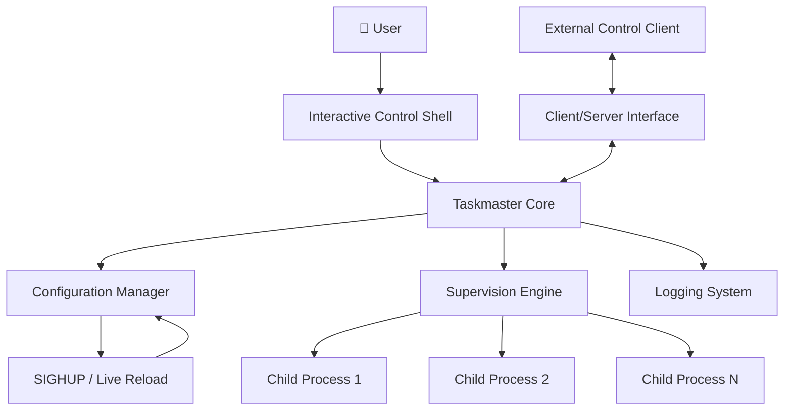
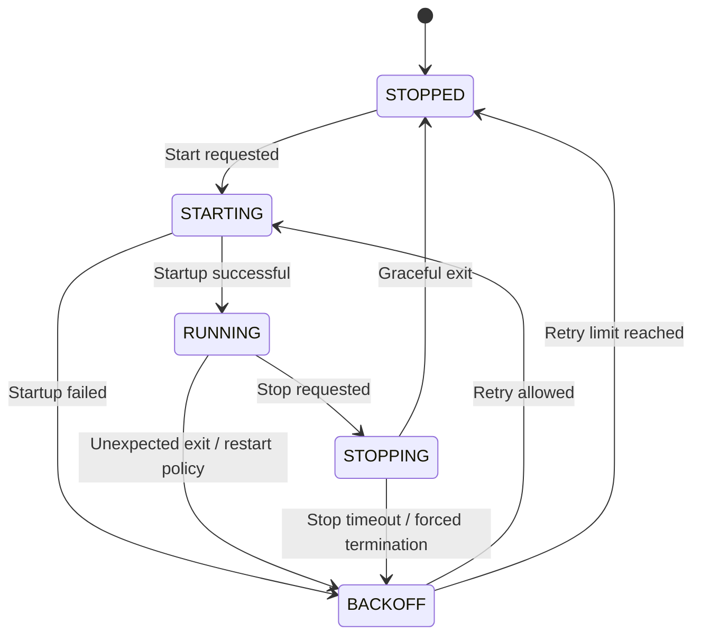
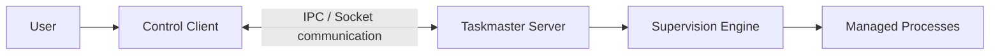

 
<div align="center">

# ⚙️ TASKMASTER

### A Process Supervision & Job Control System


A Unix process supervisor inspired by [Supervisor](https://supervisord.org/), designed to manage child processes, automatically recover from failures, and provide an interactive control interface.

[](https://isocpp.org/)
[](https://en.wikipedia.org/wiki/Unix)
[](https://github.com/tren-chvl/-taskmaster)

</div>

---

## 🖥️ Overview

**Taskmaster** is a process supervision system written in C++ that manages programs throughout their lifecycle.

It launches processes, monitors their execution, detects unexpected exits, and restarts them according to configurable policies. An interactive control shell allows users to inspect process states, manage services, and reload configuration without restarting the supervisor itself.

The project also implements the bonus features, including a client/server architecture, privilege management, and advanced process interaction.

> The goal: build a lightweight, configurable alternative inspired by the core principles of Supervisor.

## ✨ Features at a glance

| Feature | Description |
|:--|:--|
| 🔄 Process supervision | Monitor child processes and recover from failures |
| 🚀 Automatic startup | Launch configured programs when Taskmaster starts |
| ♻️ Restart policies | Support `always`, `never`, and `unexpected` restart behavior |
| 📊 Process status | Inspect the current state of supervised programs |
| 🔧 Interactive shell | Start, stop, restart, and manage programs |
| 🔃 Live configuration reload | Apply configuration changes through `SIGHUP` |
| 📝 Logging | Record lifecycle events and process activity |
| ⚙️ Flexible configuration | Control process counts, signals, timeouts, environments, and output |
| 🔌 Client/server architecture | Separate process supervision from remote control |
| 🛡️ Privilege management | Support privilege de-escalation |
| 🖥️ Process interaction | Provide advanced terminal/process interaction capabilities |

## 🏗️ Architecture

Taskmaster is organized around a supervision engine, a configuration-driven process manager, and a user-facing control interface.



### How it works

1. **Load configuration:** Taskmaster reads the configuration file and identifies the programs to supervise.
2. **Start processes:** Programs configured for automatic startup are launched as child processes.
3. **Monitor execution:** The supervision engine tracks process states and detects termination.
4. **Recover when necessary:** Restart policies determine whether a process must be relaunched.
5. **Control at runtime:** Users can inspect, start, stop, and restart programs through the control interface.
6. **Reload without a full restart:** Sending `SIGHUP` triggers configuration reloading while preserving unchanged processes.
7. **Keep track of events:** Lifecycle events are recorded in the logging system.

## 🔄 Process lifecycle



The exact transition depends on the configured startup timeout, expected exit codes, restart policy, retry limit, and stop signal.

## 🛠️ Tech stack

- **C++** — process management and supervision logic.
- **POSIX / Unix APIs** — process control, signals, and operating-system interaction.
- **Make** — compilation and build management.
- **JsonCpp** — JSON-related functionality used by the project.
- **Configuration files** — define process behavior and runtime options.
- **Client/server communication** — provide a separate control client.

The implementation is built with the C++ compiler and links against `jsoncpp`, as configured in the Makefile.

## 📦 Installation

### Requirements

Before building, ensure that your environment provides:

- A Unix-like operating system or the project's supported virtual machine.
- A C++ compiler.
- GNU Make.
- JsonCpp development headers and library.

### Clone the repository

```bash
git clone https://github.com/tren-chvl/-taskmaster.git
cd -taskmaster
```

### Build the project

```bash
make
```

The Makefile builds the main `taskmaster` executable and the client target.

### Other build commands

```bash
make clean   # Remove object files
make fclean  # Remove generated build artifacts
make re      # Clean and rebuild
```

> **Note:** The exact runtime invocation depends on the configuration-file path and the arguments implemented by the executable. Check the project's usage output or source code before launching it.

## ⚙️ Configuration

Taskmaster uses a configuration file to define the programs it supervises and the rules that govern their execution.

The following is an illustrative YAML-style configuration based on the project specification. Adapt the file format and option names to the parser implemented in your version.

```yaml
programs:
  worker:
    cmd: "/usr/bin/python3 worker.py"
    numprocs: 2

    autostart: true
    autorestart: unexpected

    exitcodes:
      - 0

    startretries: 3
    starttime: 5

    stopsignal: TERM
    stoptime: 10

    workingdir: "/tmp"
    umask: 022

    stdout: "/tmp/worker.stdout"
    stderr: "/tmp/worker.stderr"

    env:
      APP_ENV: production
      STARTED_BY: taskmaster
```

### Configuration reference

| Option | Purpose |
|:--|:--|
| `cmd` | Command used to launch the program |
| `numprocs` | Number of process instances to maintain |
| `autostart` | Whether to launch the program at startup |
| `autorestart` | Restart policy: `always`, `never`, or `unexpected` |
| `exitcodes` | Exit codes considered successful or expected |
| `startretries` | Maximum number of startup attempts |
| `starttime` | Time required for startup to be considered successful |
| `stopsignal` | Signal used for graceful termination |
| `stoptime` | Time allowed before forced termination |
| `workingdir` | Working directory for the child process |
| `umask` | File-creation permission mask |
| `stdout` | Standard output destination |
| `stderr` | Standard error destination |
| `env` | Environment variables passed to the process |

The supported syntax and default values should match the configuration parser in the repository.

## 🎮 Control interface

The control interface is designed to manage processes without manually interacting with every child process.

The required control operations include:

| Command / action | Purpose |
|:--|:--|
| `status` | Display the state of supervised programs |
| `start` | Start a program |
| `stop` | Stop a program |
| `restart` | Restart a program |
| Configuration reload | Apply configuration changes at runtime |
| Main process shutdown | Stop Taskmaster cleanly |

> Use the exact command syntax exposed by your implementation. The table describes the required operations, not necessarily the literal command grammar.

### Live configuration reload

Taskmaster supports configuration reload through `SIGHUP`.

```bash
kill -HUP <taskmaster_pid>
```

The supervisor should apply changes to its monitored programs while avoiding unnecessary termination of processes whose configuration has not changed.

## 📝 Logging and observability

Logging makes it possible to understand what happened during the lifetime of a supervised process.

Useful events include:

- Program started.
- Program stopped.
- Program restarted.
- Unexpected process termination.
- Startup or restart failure.
- Configuration reloaded.
- Forced termination after a timeout.

Taskmaster includes a `logs/` directory in its repository structure. Refer to the configured log destination when inspecting runtime events.

## 🚀 Bonus features

Beyond the mandatory process supervision requirements, this project implements the bonus features.

### 🔌 Client/server architecture

The control interface can be separated from the process supervision engine.



This separation makes it possible to control supervised processes through a dedicated client rather than relying exclusively on the main process's interactive shell.

### 🛡️ Privilege management

Taskmaster includes privilege-related functionality intended to support launching processes with reduced privileges where configured and permitted by the operating system.

Privilege changes should follow the principle of least privilege and be tested carefully in a dedicated environment.

### 🖥️ Advanced process interaction

Taskmaster includes process terminal-interaction functionality, allowing more advanced interaction with supervised processes.

This extends the project beyond basic start/stop supervision and explores concepts used by terminal multiplexers and process-control tools.

### 📝 Logging and runtime diagnostics

Process lifecycle events and failures can be recorded for easier troubleshooting and monitoring.

### Bonus summary

- [x] Client/server architecture.
- [x] Privilege management.
- [x] Advanced process/terminal interaction.
- [x] Logging and runtime diagnostics.

## 📁 Project structure

```text
-taskmaster/
├── src/
│   ├── bonus/
│   │   ├── client_ctl/
│   │   └── root/
│   ├── task/
│   │   ├── log.cpp
│   │   ├── pid.cpp
│   │   ├── prog.cpp
│   │   ├── pty.cpp
│   │   ├── reload.cpp
│   │   ├── shell.cpp
│   │   ├── status.cpp
│   │   └── supervision.cpp
│   ├── colors.cpp
│   ├── main.cpp
│   └── taskmaster.cpp
├── sh/
├── logs/
├── Makefile
└── taskmaster.hpp
```

*This tree highlights the main components visible in the repository; generated files and additional files may be omitted.*


## 🔐 Security considerations

Taskmaster interacts directly with operating-system processes. Run experiments in an isolated virtual machine, use least-privilege accounts, and avoid testing privilege-management functionality on a production system.

## 🎯 Project goals

This project explores several important Unix and systems-programming concepts:

- Process creation and lifecycle management.
- Signals and graceful shutdown.
- Process monitoring and recovery.
- Configuration parsing and runtime reloading.
- Inter-process communication.
- Logging and diagnostics.
- Terminal interaction.
- Privilege management.

## 📚 References

- [Supervisor — Process Control System](https://supervisord.org/)
- [GNU Make Manual](https://www.gnu.org/software/make/manual/)
- [Linux man-pages](https://man7.org/linux/man-pages/)
- [POSIX specifications](https://pubs.opengroup.org/onlinepubs/9799919799/)

## 👤 Author

**tren-chvl**

GitHub repository: [github.com/tren-chvl/-taskmaster](https://github.com/tren-chvl/-taskmaster)

---

<div align="center">

**TASKMASTER**

*Reliable process supervision. Controlled execution. Automatic recovery.*

</div>
